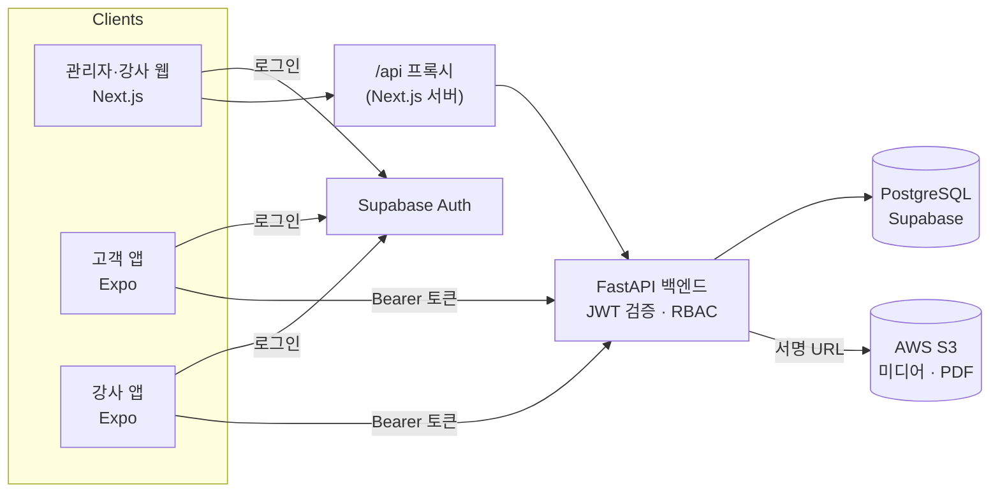

<div align="center">

# ⛳ CRM Core

**골프 레슨 CRM** — 강사·고객·관리자를 하나의 플랫폼으로 연결합니다

예약 · 수강권 · 레슨노트 · 채팅 · 매출 분석을 한 백엔드와 세 개의 클라이언트(웹, 고객 앱, 강사 앱)로 제공합니다


</div>

---

## 목차

- [데모](#-데모)
- [앱 소개](#-앱-소개)
- [아키텍처](#-아키텍처)
- [기술 스택](#-기술-스택)
- [도메인](#-도메인)
- [빠른 시작](#-빠른-시작)
- [개발·배포 흐름](#-개발배포-흐름)
- [테스트와 운영](#-테스트와-운영)
- [문서](#-문서)

---

## 👀 데모

| 클라이언트 | 링크 | 데모 계정 |
|---|---|---|
| 관리자·강사 웹 | 준비 중 | 강사 · 관리자 |
| 고객 앱 (브라우저) | 준비 중 | 고객 |
| 강사 앱 (브라우저) | 준비 중 | 강사 |

> 무료 호스팅이라 첫 접속은 30초~1분 걸릴 수 있습니다. 브라우저 버전에서는 사진 스캔 → PDF, 푸시 알림이 동작하지 않습니다.
> 배포 방법: [`docs/operations/demo-deploy.md`](docs/operations/demo-deploy.md)

---

## 📱 앱 소개

골프 강사 한 명이 고객을 모으고, 레슨을 예약받고, 수강권과 매출을 관리하는 흐름을 하나로 묶었습니다.
고객은 앱으로 강사를 찾아 문의하고 예약하며, 강사는 앱으로 현장 업무를, 웹으로 관리·분석 업무를 합니다.

### 고객 앱 — `apps/customer`

강사를 찾고, 레슨을 예약하고, 내 수강권과 레슨 기록을 보는 앱입니다.

| 기능 | 내용 |
|---|---|
| 강사 찾기 | 단계별 매칭(목적 → 지역 → 추천 강사), 강사 목록·상세 프로필(경력·자격증) → **문의하기**로 채팅방 열기 |
| 채팅 | 강사와 1:1 대화, 채팅방에서 **담당 강사로 지정** (지정해야 수강권 구매·예약이 열림) |
| 예약 | 월간 달력에서 강사의 예약 가능 시간 확인 → 레슨 신청 · 취소 신청 · 철회 |
| 홈 | 오늘·이번 주·이번 달 예약, 확정·일정 알림 |
| 수강권 | 내 수강권 남은 횟수, 담당 강사의 수강권 상품과 진행 중 할인·이벤트 |
| 레슨노트 | 강사가 남긴 노트(글·스캔 PDF) 보기 |
| 게시글 | 강사 홍보·공지 피드, 사진·영상, 좋아요·댓글 |
| 내 정보 | 프로필 수정, 피드백 공개 동의, 로그아웃, 회원 탈퇴 (거래 기록은 5년 보존) |

**스택**: Expo 54 · React Native · Expo Router · Supabase Auth · AsyncStorage · react-native-calendars · expo-video · Sentry

### 강사 앱 — `apps/instructor`

레슨 현장에서 쓰는 강사용 앱입니다. 예약 처리와 고객 관리, 레슨노트 작성을 폰으로 바로 합니다.

| 기능 | 내용 |
|---|---|
| 대시보드 | 담당 고객 수·상태별 예약 수, 레슨 신청 확정·거절, 취소 신청 승인·거절, 오늘 예약 완료·노쇼 |
| 스케줄 | 월간 달력, 날짜별 예약, 휴무 관리 (임시 휴무일 · 특정 시간 닫기 · 정기 휴무일 열기) |
| 고객 관리 | 담당 고객 목록·검색, 이메일로 등록, 고객 상세(발급 수강권) |
| 레슨노트 | 고객별 노트 작성, **수기 노트를 사진으로 찍어 PDF로 변환**, PDF 첨부 |
| 게시물 | 홍보·공지 작성, 사진·영상 첨부(S3 직접 업로드) |
| 수강권·매출 | 수강권 상품 관리·발급·횟수 추가, 결제 내역·수동 등록, 운영 현황(매출 분석·프로모션 확인) |
| 내 정보 | 강사 프로필(지역·전문 분야·경력·자격증), 정기 휴무 요일 |

**스택**: Expo 54 · React Native · Expo Router · Supabase Auth · expo-image-picker · expo-print · expo-document-picker · expo-video · react-native-calendars · Sentry

### 관리자·강사 웹 — `frontend`

넓은 화면이 필요한 관리·분석 업무를 위한 웹입니다. 로그인한 역할에 따라 강사 화면과 관리자 화면으로 나뉩니다.

| 기능 | 내용 |
|---|---|
| 강사: 운영 | 대시보드(예약 처리), 고객 관리(전화번호·이메일 등록), 스케줄 슬롯, 게시물, 레슨노트 |
| 강사: 매출 분석 | 최근 6개월 월별 매출, 결제수단·수강권별 합계, 고객·수강권 현황 |
| 강사: 프로모션 | 수강권 할인(비율·금액)·이벤트 만들기·중지·삭제 → 고객 앱 수강권 탭에 표시 *(프로토타입)* |
| 관리자 | 대시보드, 강사 관리 · 시스템 관리 · 영업/통계 *(준비 중)* |

**스택**: Next.js 16 (App Router) · React 19 · TanStack Query · Tailwind CSS · Supabase Auth (SSR 쿠키 세션) · `/api` 프록시

### 백엔드 — `backend`

세 클라이언트가 같은 API 계약을 쓰는 단일 백엔드입니다. 예약 상태 전환, 수강권 차감, 휴무 규칙, 거래 기록 보존 같은 규칙을 모두 여기서 처리합니다.

**스택**: FastAPI (async) · SQLModel · PostgreSQL (asyncpg, 커넥션 풀) · Alembic · Supabase JWT 검증 + RBAC · AWS S3 서명 URL · slowapi · Sentry · pytest (183개)

---

## 🏗 아키텍처



```text
CRM_Core/
├── backend/          # FastAPI 백엔드 (도메인별 models · schemas · router · repository)
├── frontend/         # 관리자·강사용 웹 (Next.js)
├── apps/customer/    # 고객 모바일 앱 (Expo React Native)
├── apps/instructor/  # 강사 모바일 앱 (Expo React Native)
├── packages/         # 공통 패키지 (api, ui — 예정)
└── docs/             # 운영 문서 · 진행 현황 · 포트폴리오
```

**설계 원칙**
- 백엔드는 도메인 단위로 나누고, router 는 요청 파싱·권한 확인·응답 변환만, 규칙과 상태 변경은 repository 에 둔다
- 웹은 브라우저가 백엔드를 직접 부르지 않고 `/api/[...path]` 프록시만 거친다. 앱은 `lib/api.ts` 가 토큰을 붙인다
- 결제·수강권 같은 거래 데이터는 회원 탈퇴 후에도 5년 보존한다 (개인정보만 삭제)

### 인증 흐름

1. Supabase Auth 로그인 및 세션 발급
2. 백엔드에서 Supabase JWT 검증 (Supabase 검증이 안 될 때만 쓰는 긴급 폴백: HS256 로컬 JWT)
3. 최초 로그인 시 JIT 유저 자동 생성
4. RBAC 역할 검증 (`CUSTOMER` · `INSTRUCTOR` · `CONTENT_MANAGER` · `ADMIN`) — 권한이 없으면 `/forbidden`

---

## 🧰 기술 스택

| 영역 | 기술 |
|------|------|
| 백엔드 | FastAPI · SQLModel · PostgreSQL (AsyncPG) · Alembic · Poetry · slowapi · Sentry |
| 관리자·강사 웹 | Next.js 16 · React 19 · Supabase Auth · Zustand · TanStack Query · Tailwind CSS |
| 고객 앱 · 강사 앱 | Expo 54 · React Native · Expo Router · Supabase Auth · Sentry |
| 인증 | Supabase JWT (주) · HS256 로컬 JWT (긴급 폴백) · RBAC |
| 파일 저장소 | AWS S3 (비공개 버킷 + 서명 URL) — 게시물 미디어 · 레슨노트 PDF |
| 배포 | AWS Copilot (환경별 Manifest + Addon) · GitHub Actions |

---

## 🧩 도메인

| 도메인 | 기능 |
|--------|------|
| `auth` | Supabase 기반 인증 · JIT 유저 생성 · 아이디/비밀번호 로그인 |
| `users` | 사용자 관리 · RBAC · 담당 강사 지정 · 회원 탈퇴(기록 보존) |
| `instructor` | 강사 승인 · 담당 고객 등록 · 공개 프로필 · 매출·운영 대시보드 |
| `calendar` | 캘린더 · 타임슬롯 · 휴무(정기·임시·날짜별 열기/닫기) · 예약 가능 시간 |
| `booking` | 레슨 예약 신청 · 확정·거절·취소·완료·노쇼 · 수강권 차감 |
| `lesson_notes` | 레슨노트 (글 · 스캔 PDF, 고객별) |
| `passes` | 수강권 상품 · 발급 · 사용 관리 |
| `payment` | 결제 기록 · 상태 관리 (5년 보존) |
| `promotions` | 강사 할인·이벤트 프로모션 (프로토타입) |
| `posts` | 게시물(홍보·공지·커뮤니티) · 댓글 · 좋아요 · 미디어 |
| `notifications` | 알림 (댓글·좋아요 등) |
| `chat` | 고객–강사 1:1 채팅 (문의하기) |
| `matching` | 강사 매칭 신청 API · 모임 찾기(예정) |

---

## 🚀 빠른 시작

각 폴더의 README 에 상세 가이드가 있습니다. 전체 명령은 `make help`.

```bash
make check   # 외부 서비스 없이 전체 검증 (로컬 DB 테스트 + 웹 lint·타입 + 두 앱 타입)

make api     # 백엔드 (backend/.env)
make web     # 관리자·강사 웹 (http://localhost:3000)
make cweb    # 고객 앱 (브라우저)
make iweb    # 강사 앱 (브라우저, 포트 8082)
```

> env 파일은 폴더마다 따로 둡니다 (`backend/.env`, `frontend/.env.local`, `apps/customer/.env`, `apps/instructor/.env`). Expo 앱은 상위 디렉터리의 `.env` 를 읽지 않습니다. 변수 이름과 구하는 곳은 [`docs/operations/env-setup.md`](docs/operations/env-setup.md).

---

## 🔁 개발·배포 흐름

```text
작업 브랜치 → PR → CI → staging → Release PR → main → Prod 배포
```

| 단계 | 내용 |
|---|---|
| 1. 개발 | 작업 브랜치 (`feat/*` · `fix/*` · `refactor/*` · `docs/*` · `wip/*`) → `staging` 대상 PR |
| 2. CI | 바뀐 폴더만 검사: 백엔드 테스트 · 웹 린트/빌드 · 두 앱 타입 검사 |
| 3. 스테이징 | `staging` merge → **deploy-staging** 자동 실행 → 성공 시 "Release: Staging → Main" PR 자동 생성 (AWS 중단 중에는 `make gitpr`) |
| 4. 운영 | Release PR 확인 후 merge → **deploy-prod** 자동 실행 |

> **현재 운영 상태**: AWS 환경은 비용 절감을 위해 중단된 상태입니다. CI 는 정상 동작하고, 스테이징 실환경 검증은 AWS 재가동 시 활성화됩니다.

| 구분 | Copilot 환경명 | 용도 |
|------|---------------|------|
| 로컬 | `local` | 로컬 / Codespace 개발 |
| 스테이징 | `staging` | 운영 배포 전 AWS 리허설 환경 |
| 운영 | `prod` | 실제 운영 환경 |

```bash
make stgdeploy / make proddeploy   # 수동 배포 (긴급 복구)
make stglogs   / make prodlogs     # 로그 확인
```

---

## ✅ 테스트와 운영

```bash
make apitest   # 로컬 DB 새로 만들기 → alembic check → pytest (원격 DB 연결 없음)
make check     # PR 전 전체 검증
```

백엔드 테스트는 도메인별 파일로 나뉘어 있습니다 ([`backend/README.md`](backend/README.md#테스트)).

**운영 원칙**
- CI 실패 상태에서 merge 금지, Staging 확인 없이 Prod 배포 금지
- Prod 배포는 항상 PR 승인 단계를 거친다
- 이미 공유/배포된 Alembic revision 은 절대 수정하지 않는다

**장애 대응 체크리스트**: CI 상태 → Staging 상태 → 로그(`make stglogs` / `make prodlogs`) → 환경변수·시크릿 → DB 진단

```bash
make dbcheck    # DB 연결 확인
make dbschema   # 모델 ↔ DB 스키마 확인
make migcheck   # 마이그레이션 차이 확인 (읽기 전용)
```

---

## 📚 문서

| 문서 | 내용 |
|------|------|
| [`backend/README.md`](backend/README.md) | 백엔드 개발 가이드 |
| [`frontend/README.md`](frontend/README.md) | 관리자·강사 웹 개발 가이드 |
| [`apps/customer/README.md`](apps/customer/README.md) | 고객 앱 개발 가이드 |
| [`apps/instructor/README.md`](apps/instructor/README.md) | 강사 앱 개발 가이드 |
| [`docs/operations/`](docs/operations/) | 개발 Runbook · env 설정 · 실제 환경 검증 · PG 연동 방법 · 트러블슈팅 · AWS 운영 |
| [`docs/requirements/`](docs/requirements/) | 요구사항 정의서 |
| [`docs/progress.md`](docs/progress.md) | 진행 현황 · 테스트할 것 · 보류 · 해야 할 것 · 결정 기록 |
| [`docs/portfolio/`](docs/portfolio/) | 문제 해결 기록 (예: DB 커넥션 성능 개선) |
